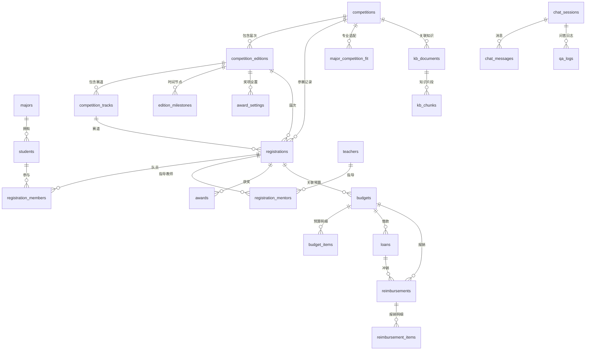

# 数据库设计

数据库采用 SQLAlchemy 2.0 声明式模型，默认 SQLite，支持 MySQL 8 与 PostgreSQL 16。共 **27 张表**，分为基础主数据、竞赛台账、经费单据、规则表、知识库、会话与运行日志六组。

设计目标：

1. **统计以结构化数据为准**：参赛、获奖、成员、教师关联均有独立表，统计服务只读取这些表。
2. **赛事与规则不固化**：赛事本体与年度届次分离，费用、推荐、积分、检查量表均为数据表或配置文件。
3. **可溯源**：知识库片段保留文档、章节、页码、行号与原文路径；智能体运行保留节点轨迹。
4. **可迁移**：仅使用标准 SQL 类型（JSON 在 SQLite 中以 TEXT 存储），不依赖数据库专有函数。

## 1. ER 图



规则表 `award_point_rules`、`competition_category_rules`、`expense_standards` 不直接外键关联业务表，通过编码/名称匹配，便于独立调整。

## 2. 表清单

### 2.1 基础主数据

| 表 | 用途 | 关键字段 | 约束/索引 |
| --- | --- | --- | --- |
| `majors` | 专业 | `code` 专业代码、`name`、`college`、`discipline` | `code` 唯一；`name` 索引 |
| `students` | 学生 | `student_no`、`name`、`major_id`、`major_name`（冗余）、`grade`、`tech_tags`、`skill_level` | `student_no` 唯一；姓名/专业/年级索引 |
| `teachers` | 指导教师 | `teacher_no`、`name`、`title`、`college`、`department`、`research_areas`、`can_mentor` | `teacher_no` 唯一；姓名索引 |

`major_name`、`competition_name` 等冗余字段是为统计与导出避免多表连接，导入时由脚本同步维护。

### 2.2 竞赛台账

| 表 | 用途 | 关键字段 | 约束/索引 |
| --- | --- | --- | --- |
| `competitions` | 赛事本体（跨年度稳定信息） | `code`、`name`、`short_name`、`organizer`、`level`、`category`、`competition_type`、`discipline_tags`、`official_url`、`is_active` | `code` 唯一；名称、级别、类别索引 |
| `competition_editions` | 年度届次 | `competition_id`、`year`、`edition_name`、`notice_title/no`、`register_start/end`、`competition_period`、`eligibility`、`team_size_min/max`、`mentor_limit`、`registration_fee`、`required_materials`、`status` | 唯一约束 (`competition_id`,`year`,`edition_name`)；(`year`,`competition_id`) 索引 |
| `competition_tracks` | 赛道/赛项 | `edition_id`、`name`、`code`、`requirements`、`team_size_min/max`、`fee`、`discipline_tags` | 外键级联删除 |
| `edition_milestones` | 时间节点 | `edition_id`、`name`、`stage`、`start_date`、`end_date`、`note` | 外键级联删除 |
| `award_settings` | 奖项设置 | `edition_id`、`award_level`、`category`、`ratio`、`quantity`、`prize` | 外键级联删除 |
| `registrations` | 参赛记录（一队一条） | `code`、`competition_id`、`edition_id`、`track_id`、`year`、`competition_name`、`track_name`、`competition_level`、`team_name`、`project_title`、`status`、`stage_reached`、`lead_major`、`leader_name`、`mentor_names` | `code` 唯一；(`year`,`status`) 索引；名称/级别/专业索引 |
| `registration_members` | 参赛队员 | `registration_id`、`student_id`、`student_no`、`student_name`、`major_name`、`grade`、`role`、`order_no` | 外键级联删除；学号/姓名/专业索引 |
| `registration_mentors` | 参赛队指导教师 | `registration_id`、`teacher_id`、`teacher_name`、`role`、`order_no` | 外键级联删除；姓名索引 |
| `awards` | 获奖记录 | `registration_id`、`year`、`award_year`、`competition_name`、`track_name`、`award_level`、`award_grade`、`competition_level`、`project_title`、`team_name`、`students`、`majors`、`mentors`、`certificate_no`、`award_date`、`points` | (`award_year`,`award_level`) 索引；年份/等级/级别/专业索引 |

状态与等级枚举（以中文存储）：

- 参赛状态：报名中 / 备赛中 / 已提交 / 参赛中 / 已完赛 / 获奖 / 退赛。
- 晋级阶段：校赛 / 省赛 / 国赛。
- 获奖等级：特等奖 / 一等奖 / 二等奖 / 三等奖 / 优胜奖 / 入围奖。
- 获奖归属：国家级 / 省级 / 校级。
- 届次状态：往届 / 进行中 / 筹备中。

### 2.3 经费单据

| 表 | 用途 | 关键字段 | 约束/索引 |
| --- | --- | --- | --- |
| `expense_standards` | 费用标准 | `code`、`name`、`category`、`competition_level`、`region`、`value_type`（fixed/unit_price/cap/ratio）、`value`、`unit`、`condition`、`effective_from/to`、`is_active` | `code` 唯一；类别/启用状态索引 |
| `budgets` | 预算申请单 | `doc_no`、`title`、`competition_name`、`year`、`applicant_name`、`student_count`、`teacher_count`、`destination`、`trip_days`、`total_amount`、`approved_amount`、`status`、`basis`、`reviewer`、`review_date`、`generated_text`、`agent_trace` | `doc_no` 唯一；赛事/年度/状态索引 |
| `budget_items` | 预算明细 | `budget_id`、`category`、`item_name`、`unit`、`quantity`、`unit_price`、`amount`、`standard_code`、`calc_basis` | 外键级联删除；类别索引 |
| `loans` | 借款单 | `doc_no`、`budget_id`、`borrower_name/no`、`amount`、`amount_upper`、`purpose`、`competition_name`、`destination`、`expected_repay_date`、`payee`、`status`、`generated_content`、`checks` | `doc_no` 唯一；状态索引 |
| `reimbursements` | 报销单 | `doc_no`、`budget_id`、`loan_id`、`claimant_name`、`total_amount`、`approved_budget_amount`、`loan_amount`、`status`、`checks`、`completeness_score`、`generated_text` | `doc_no` 唯一；赛事/状态索引 |
| `reimbursement_items` | 报销明细 | `reimbursement_id`、`category`、`item_name`、`amount`、`expense_date`、`invoice_no`、`has_invoice`、`payee`、`standard_code`、`over_standard`、`calc_basis` | 外键级联删除；类别索引 |

单据状态流转：

| 单据 | 状态 |
| --- | --- |
| 预算 | 草稿 → 待审批 → 已批准 / 已驳回 |
| 借款 | 草稿 → 待审批 → 已借出 → 已冲销 |
| 报销 | 草稿 → 待审核 → 已通过 / 已驳回 |

报销通过时，若关联借款状态不是「已冲销」，接口会同步更新借款状态并在响应中返回 `closed_loan_doc_no`。

### 2.4 规则表

| 表 | 用途 | 关键字段 | 来源 |
| --- | --- | --- | --- |
| `major_competition_fit` | 专业/技术方向与赛事适配 | `competition_id`、`match_type`（major/tech_tag/level）、`match_value`、`fit_score`、`reason`、`recommended_grade`、`difficulty` | `competitions.json` 中各赛事的 `fits` |
| `award_point_rules` | 学生积分与教师工作量 | `award_grade`、`award_level`、`student_points`、`teacher_workload`、`source` | `rules/award_point_rules.yaml` |
| `competition_category_rules` | 赛事级别/类别认定 | `competition_name_pattern`、`level`、`category`、`score` | `rules/competition_category_rules.yaml` |

另有 YAML 规则不落库，由服务层直接读取：

- `finance_policy.yaml`：审批阈值、报销时限、票据要求、前账未清限制等。
- `recommend_weights.yaml`：推荐权重与年级适配档位。
- `review_rubrics.yaml`：材料类型、章节要求、要素关键词、答辩问题模板。
- `expense_standards.yaml`：费用标准种子（导入 `expense_standards` 表后以表为准）。

### 2.5 知识库

| 表 | 用途 | 关键字段 | 约束/索引 |
| --- | --- | --- | --- |
| `kb_documents` | 知识文档 | `title`、`doc_type`、`competition_id`、`competition_name`、`year`、`issuing_body`、`doc_no`、`effective_date`、`file_name`、`source_path`、`source_url`、`file_hash`、`tags`、`status`、`chunk_count`、`char_count`、`version` | 标题/类型/年度/状态索引；`file_hash` 索引用于去重 |
| `kb_chunks` | 知识片段 | `document_id`、`chunk_index`、`content`、`section`、`page_no`、`row_ref`、`char_count`、`tokens`、`embedding`（BLOB）、`embedding_model`、`embedding_dim`、`meta` | (`document_id`,`chunk_index`) 索引；外键级联删除 |

- 向量以 `float32` 二进制 BLOB 存储，检索时加载到内存做余弦相似度；默认 512 维。
- 不依赖独立向量数据库，便于离线迁移；如需接入专用向量库，可替换 `app/rag/vectorstore.py` 的 `KnowledgeIndex`，其余接口不变。
- `section` 保存章节路径（如「四、报名安排」），`page_no` 保存 PDF 页码，`row_ref` 保存 Excel 行标识，用于引用定位。

### 2.6 会话与运行日志

| 表 | 用途 | 关键字段 |
| --- | --- | --- |
| `chat_sessions` | 问答会话 | `title`、`agent`、`user_role`、`user_ref`、`context` |
| `chat_messages` | 会话消息 | `session_id`、`role`、`content`、`citations`、`payload`、`agent_trace`、`created_at` |
| `qa_logs` | 问答审计 | `session_id`、`agent`、`question`、`answer`、`citations`、`llm_provider`、`used_knowledge`、`used_structured_data`、`latency_ms`、`feedback` |
| `agent_run_logs` | 工作流运行 | `run_id`、`agent`、`input_payload`、`node_trace`、`output_summary`、`status`、`error`、`duration_ms`、`llm_provider`、`created_at` |

## 3. 统计口径

| 指标 | 计算方式 | 数据来源 |
| --- | --- | --- |
| 参赛队伍数 | `registrations` 按筛选条件计数 | `registrations` |
| 参赛人次 | 参赛队去重后的队员数（按学生去重）或队员记录数，统计页按人次口径 | `registration_members` |
| 获奖数量 | `awards` 计数 | `awards` |
| 获奖率 | 获奖数 / 参赛队数 × 100%，保留 1 位小数 | 计算 |
| 高等级奖项 | 获奖等级为「特等奖」或「一等奖」 | `awards.award_level` |
| 专业维度 | 以队长专业 `registrations.lead_major` 归集参赛队；获奖按归集结果匹配 | `registrations` / `awards.majors` |
| 教师维度 | `registration_mentors` 关联计数 | `registration_mentors` |
| 学生积分 | 按 `award_point_rules` 的 `student_points` 折算 | 规则表 + `awards` |
| 教师工作量 | 按 `award_point_rules.teacher_workload` 折算 | 规则表 + `awards` |
| 奖项等级占比 | 各等级获奖数 / 总获奖数 | `awards` |

时间口径：默认按 `awards.award_year` 与 `registrations.year`；筛选年度时同时约束参赛与获奖年份。统计页会显示当前筛选口径（`StatsFilter.describe()`）。

## 4. 索引与性能

- 统计高频字段已建立单列索引：`registrations.year/status/competition_level/lead_major`、`awards.award_year/award_level/award_grade`、`registration_members.major_name`、`registration_mentors.teacher_name`。
- 组合索引：`(year, status)`、`(award_year, award_level)`、`(year, competition_id)`、`(document_id, chunk_index)`。
- 统计服务一次加载筛选后的参赛与获奖 DataFrame，在 Pandas 中完成聚合，避免 N+1 查询；演示规模（80 队/55 奖）响应在 100 ms 以内。
- 知识库索引在进程内缓存；文档变更后通过 `KnowledgeIndex.ensure_loaded(force=True)` 重建。文档规模较大时建议切换外部向量库或增加分页召回。

## 5. 数据量与初始化

当前交付库（`backend/data/competition_agent.db`）的记录数：

| 表 | 行数 | 表 | 行数 |
| --- | ---: | --- | ---: |
| `competitions` | 12 | `competition_editions` | 16 |
| `competition_tracks` | 35 | `edition_milestones` | 56 |
| `award_settings` | 71 | `registrations` | 80 |
| `registration_members` | 181 | `registration_mentors` | 79 |
| `awards` | 55 | `students` | 28 |
| `teachers` | 10 | `majors` | 6 |
| `major_competition_fit` | 75 | `award_point_rules` | 18 |
| `competition_category_rules` | 48 | `expense_standards` | 24 |
| `kb_documents` | 12 | `kb_chunks` | 124 |

重新初始化：

```bash
cd backend
python scripts/init_db.py --reset --seed
python scripts/ingest_knowledge.py
```

## 6. 扩展方式

### 6.1 新增赛事与年度

不需要改表结构：通过「赛事台账」页面新增赛事与届次，或编辑 `data/seed/competitions.json` 后运行 `python scripts/seed_data.py`。赛事编码 `code` 是幂等主键，重复导入会更新而非重复插入。

### 6.2 新增年度台账

编辑 `data/seed/ledger.json` 的 `registrations` 数组，按 `code` 幂等导入。每条的成员与获奖为嵌套数组，导入脚本会重建关联记录。字段结构见 [04 知识库与结构化数据导入](04-知识库与结构化数据导入.md)。

### 6.3 新增业务表

1. 在 `app/db/models.py` 增加模型并确保被 `Base.metadata` 注册。
2. 运行 `python scripts/init_db.py` 创建缺失表（不会修改已有表）。
3. 如需变更已有列，生产环境应使用 Alembic 迁移；当前交付未内置迁移脚本，SQLite 演示库可通过重建处理。
4. 新表如参与统计，扩展 `StatsService.load_frames()` 与对应维度方法。

### 6.4 切换数据库注意事项

- MySQL 使用 `utf8mb4`，否则中文与 emoji 可能截断。
- PostgreSQL 的 JSON 字段为 `JSON`/`JSONB` 兼容类型，SQLAlchemy 会自动处理。
- 金额列使用 `Numeric(14,2)`，计算时在服务层转为 `float`，展示与导出保留 2 位小数；如需严格财务精度，可在服务层改用 `Decimal`。
- 系统已在 SQLite 连接事件中执行 `PRAGMA foreign_keys=ON` 与 WAL 模式；模型声明了 `ondelete`，ORM 关系同时配置级联删除，迁移到 MySQL/PostgreSQL 后行为一致。
